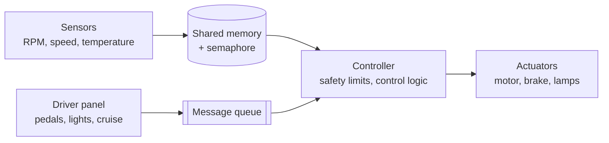

# POSIX Automotive Systems in C

[](https://github.com/thiagoricardop/posix-project/actions/workflows/ci.yml)


[](LICENSE)

Two embedded-style vehicle simulators built with the **POSIX API** during the
Automotive Software Development residency (UFPE). They model how an in-vehicle
system is split into cooperating processes - sensors, driver inputs and a
central controller - that communicate through standard IPC and enforce safety
limits.

| Project | What it is | Key concepts |
|---|---|---|
| [**TP1 - Multi-process vehicle simulator**](tp1-ipc-vehicle-simulator) | Sensor threads, driver panel and central controller on a Linux PC. | Shared memory, named semaphores, message queues, pthreads, signals, final test report |
| [**TP2 - Raspberry Pi vehicle controller**](tp2-gpio-vehicle-controller) | Hall-sensor acquisition, PWM motor/brake drive, lights and cruise control on a Raspberry Pi 4, with a hardware-free GPIO simulator. | GPIO, 1 kHz soft PWM, on/off control, event-driven design, hardware abstraction |

## System at a glance



## Highlights

- **IPC design**: process separation with shared memory guarded by a named semaphore, asynchronous commands over a message queue, and one thread per sensor.
- **Real-time friendly**: event-driven loops (`mq_timedreceive`, `select`) with no busy waiting; clean `EINTR` and signal handling.
- **Safety logic**: speed, temperature and RPM limits trigger a controlled stop, counted in a final report (TP1) and cancelling the cruise control (TP2).
- **Testable without hardware**: `make SIM=1` swaps WiringPi for a shared-memory GPIO simulator, so CI exercises the full TP2 system end to end.
- **Secure by default**: owner-only (`0600`) IPC objects, input validation on every message, stack protector and strict warnings, `cppcheck` static analysis on every push.

## Quick start

```bash
# TP1 - needs only gcc and make
cd tp1-ipc-vehicle-simulator
make test        # builds and runs the end-to-end test
make             # then start ./build/controller, ./build/sensors, ./build/car_panel

# TP2 - simulated GPIO, runs on any Linux machine
cd ../tp2-gpio-vehicle-controller
make test        # builds with SIM=1 and runs the end-to-end test
```

Each project README explains the architecture, usage and results in detail.

## Repository layout

```text
.
├── tp1-ipc-vehicle-simulator/     POSIX IPC simulator (Linux)
├── tp2-gpio-vehicle-controller/   GPIO / PWM controller (Raspberry Pi + simulator)
└── .github/workflows/ci.yml       build, static analysis and tests for both projects
```

## Demo videos

- [TP1 walkthrough](https://drive.google.com/file/d/17fvRN1bZjXgz1VY6tg0dB2y_kvAi2SSb/view?usp=sharing)
- [TP2 walkthrough](https://drive.google.com/file/d/1Pi-zo6gOERhtJ3EF8hF6c3aSUtCaY6M7/view?usp=sharing)

## Author

**Thiago Ricardo** - Embedded software and cybersecurity engineer, M.Sc. Cybersecurity Engineering at Politecnico di Torino.
[LinkedIn](https://www.linkedin.com/in/thiagoricardop) | [GitHub](https://github.com/thiagoricardop)

## License

MIT - see [LICENSE](LICENSE).
