

**Simulação de Comunicação em Sistema Automotivo Utilizando CAN**

Thiago Ricardo Oliveira Pinto

***Abstract***

*The project implements a car dashboard simulation system using advanced C programming concepts and Inter-Process Communication (IPC). The system consists of three main components: a controller, a sensor, and a command panel, which communicate through shared memory, semaphores, and POSIX message queues. The controller manages the system state, monitoring and responding to changes in speed, temperature, and engine RPM, as well as controlling features such as headlights and turn signals. The system implements safety measures, such as speed and temperature limits, and uses proper synchronization to avoid race conditions in accessing shared data. The user interface displays vehicle information in real-time, allowing interaction through specific commands to control different car functionalities, such as acceleration, braking, and activation of turn signals and headlights.*

***Resumo***

*O projeto implementa um sistema de simulação de painel de carro utilizando conceitos avançados de programação em C e comunicação entre processos (IPC). O sistema é composto por três componentes principais: um controlador, um sensor e um painel de comando, que se comunicam através de memória compartilhada, semáforos e filas de mensagens POSIX. O controlador gerencia o estado do sistema, monitorando e respondendo a mudanças na velocidade, temperatura e RPM do motor, além de controlar funcionalidades como faróis e setas. O sistema implementa medidas de segurança, como limites de velocidade e temperatura, e utiliza sincronização adequada para evitar condições de corrida no acesso aos dados compartilhados. A interface do usuário apresenta as informações do veículo em tempo real, permitindo interação através de comandos específicos para controle das diferentes funcionalidades do carro, como aceleração, frenagem e acionamento de setas e faróis.*

**1. Introdução**

**1.1 Contextualização**

Este trabalho tem como objetivo desenvolver um simulador de sistema automotivo que integra diferentes sensores e atuadores, utilizando processos interconectados através de mecanismos IPC POSIX. Uma das principais funcionalidades é a simulação em tempo real do comportamento do veículo, realizada pelo Controlador Central, com base em dados dos sensores e comandos do usuário. Para a execução dessa tarefa, serão empregadas bibliotecas padrão POSIX, que possibilitam o desenvolvimento de aplicações multiprocesso e multithread, garantindo a coordenação e o gerenciamento de recursos entre os componentes do sistema.

**1.2 Objetivos do Projeto**

O objetivo principal deste projeto é desenvolver um sistema que simule um ambiente de testes para veículos autônomos, permitindo:

1. Simular o funcionamento de sensores automotivos básicos
1. Processar dados em tempo real
1. Gerenciar a interação entre diferentes subsistemas do veículo
1. Responder a comandos do usuário
1. Gerar relatórios de desempenho e comportamento

**1.3 Solução proposta**

A solução implementada consiste em um sistema distribuído em três processos principais:

1. Simulador de Sensores: Responsável por gerar dados simulados de:
   1. Velocidade do veículo
   1. Rotação do motor (RPM)
   1. Temperatura do motor
1. Painel de Comandos: Interface que permite ao usuário controlar:
   1. Setas direcionais
   1. Sistema de iluminação
   1. Pedais de acelerador e freio

1. Controlador Central: Núcleo do sistema que:
   1. Gerencia a comunicação entre processos
   1. Processa dados dos sensores
   1. Controla os atuadores
   1. Gera relatórios de operação

**2. Desenvolvimento**

Neste Capítulo será abordado o funcionamento dos módulos de Simulação de Sensores, Painel de Comandos e Controlador Central.

A arquitetura do sistema foi projetada seguindo um modelo distribuído, onde diferentes componentes interagem através de mecanismos de comunicação interprocessos (IPC) padronizados pelo POSIX. Esta abordagem permite uma clara separação de responsabilidades e facilita a manutenção e expansão do sistema.

O sistema é composto por três processos principais que se comunicam através de memória compartilhada e fila de mensagens:

- ` `Simulador de Sensores
- Painel de Comandos
- Controlador Central

**2.1. Sensores**

O Simulador de Sensores é responsável por gerar e gerenciar dados simulados de três sensores principais do veículo: velocidade, RPM e temperatura do motor. Os dados são armazenados em memória compartilhada e protegidos por semáforos para garantir a consistência das informações.

**2.1.1 Estrutura do Código**

O código implementa as seguintes funcionalidades essenciais:

- Simulação multithread dos sensores
- Gerenciamento de memória compartilhada
- Sincronização via semáforos
- Cálculos realistas dos parâmetros do veículo

**2.1.2 Descrição do Código**

A estrutura *SensorData* armazena os dados dos sensores e estados do veículo. O acesso a estes dados é protegido por um semáforo para evitar condições de corrida.

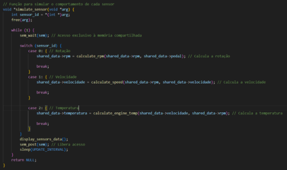

**Figura 2.1.1.: Função *simulate\_sensorl().***

Os cálculos dos parâmetros são realizados por funções específicas:

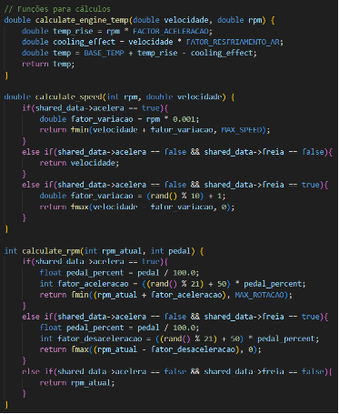

**Figura 2.1.2.: Funções de cálculo dos sensores*.***

A inicialização do sistema de sensores é uma etapa crítica que envolve a configuração da memória compartilhada, semáforos e threads. Esta seção detalha o processo de inicialização implementado na função main().

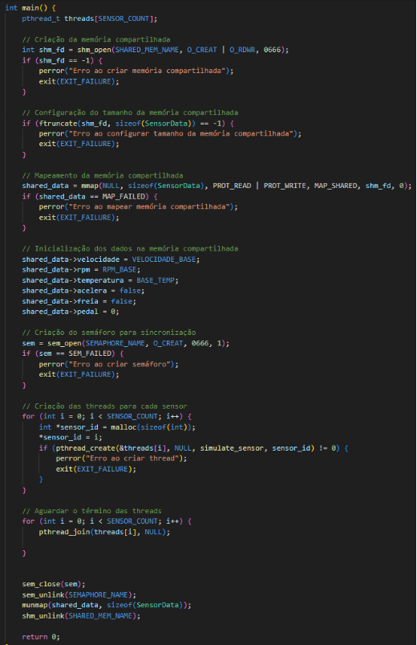

**Figura 2.1.4.: inicialização do sistema*.***

O processo de criação da memória compartilhada envolve duas etapas principais:

- Criação do objeto de memória compartilhada usando *shm\_open()*
- Configuração do tamanho da memória usando *ftruncate()*

O mapeamento da memória compartilhada para o espaço de endereçamento do processo é realizado através da função *mmap()*, permitindo o acesso direto aos dados através do ponteiro *shared\_data*. Após o mapeamento bem-sucedido, os valores iniciais dos sensores são estabelecidos: a velocidade é iniciada em 0 km/h, o RPM em 800 (marcha lenta), e a temperatura do motor em 80°C. Adicionalmente, os estados de controle como aceleração e frenagem são inicializados como falsos, e o pedal é configurado em sua posição inicial.

Para garantir a sincronização no acesso aos dados compartilhados, um semáforo é criado utilizando *sem\_open()*. Este semáforo permite acesso exclusivo à memória compartilhada e previne condições de corrida entre as diferentes threads do sistema. A implementação do semáforo é crucial para manter a integridade dos dados durante a simulação.

O sistema então procede com a criação das threads dos sensores, onde cada sensor é representado por uma thread independente. O processo de criação utiliza *pthread\_create()*, passando como parâmetro a função *simulate\_sensor* e um identificador único para cada sensor. Esta abordagem permite que cada sensor opere de forma independente, atualizando seus valores na memória compartilhada de acordo com suas próprias características e intervalos de atualização.

A finalização do sistema é igualmente importante, implementando uma sequência ordenada de liberação de recursos. O código utiliza *pthread\_join()* para aguardar o término de todas as threads, garantindo uma finalização coordenada. Em seguida, procede com o fechamento e remoção do semáforo através de *sem\_close()* e *sem\_unlink()*, respectivamente. Por fim, a memória compartilhada é desmapeada com *munmap()* e o objeto de memória compartilhada é removido usando *shm\_unlink()*.

**2.2. Controlador**

O Controlador Central é responsável por gerenciar e coordenar todos os subsistemas do veículo, processando dados dos sensores e comandos do usuário. O sistema utiliza memória compartilhada para acesso aos dados dos sensores e fila de mensagens para receber comandos do painel, garantindo uma operação sincronizada e segura.

**2.2.1 Estrutura do Código**

O código implementa as seguintes funcionalidades essenciais:

- Gerenciamento de estados do veículo
- Processamento de sinais do sistema
- Comunicação via memória compartilhada e fila de mensagens
- Controle de atuadores do veículo

**2.2.2 Descrição do Código**

A estrutura SystemState mantém o estado atual de todos os componentes do veículo. O sistema utiliza semáforos para sincronização e uma fila de mensagens para comunicação com o painel.

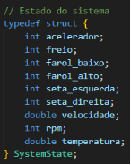

**Figura 2.2.1.: Estrutura para o estado do sistema.**

A função *main()* inicia com a configuração dos manipuladores de sinais essenciais para o controle do sistema. O código estabelece tratadores para SIGUSR1 e SIGUSR2, permitindo o controle externo da execução do simulador:

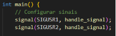

**Figura 2.2.2.: Tratadores de sinais*.***

Esta implementação permite que o sistema responda a sinais externos para pausar, retomar ou encerrar a execução, fornecendo controle granular sobre o funcionamento do simulador.

O próximo bloco de código trata da configuração da memória compartilhada para a comunicação com o módulo de sensores:

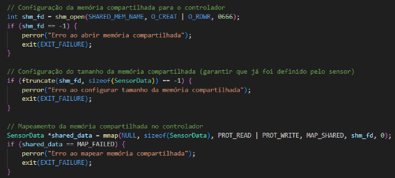

**Figura 2.2.3.: Configuração da memória compartilhada*.***

Este processo envolve a criação do objeto de memória compartilhada e a configuração de seu tamanho. O sistema implementa verificações de erro para garantir a inicialização adequada.

O código prossegue com a configuração do semáforo que implementa o mecanismo de sincronização necessário para evitar condições de corrida.:

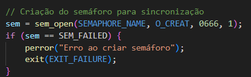

**Figura 2.2.4.: Inicialização do semáforo*.***

A inicialização da fila de mensagens POSIX é realizada com configurações para garantir uma comunicação eficiente com o painel de comandos:

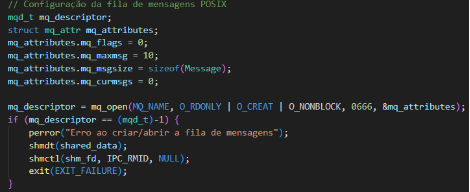

**Figura 2.2.5.: Inicialização da fila de mensagens*.***

A configuração não-bloqueante permite que o sistema continue operando mesmo quando não há comandos pendentes.

O coração do sistema é implementado em um loop que monitora continuamente o estado do veículo e processa comandos quando necessário:

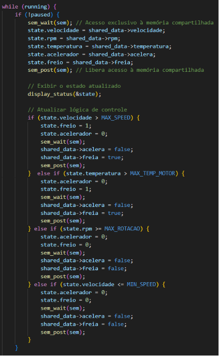

**Figura 2.2.6.: Verificação dos limites*.***

O sistema processa comandos recebidos do painel através da fila de mensagens:

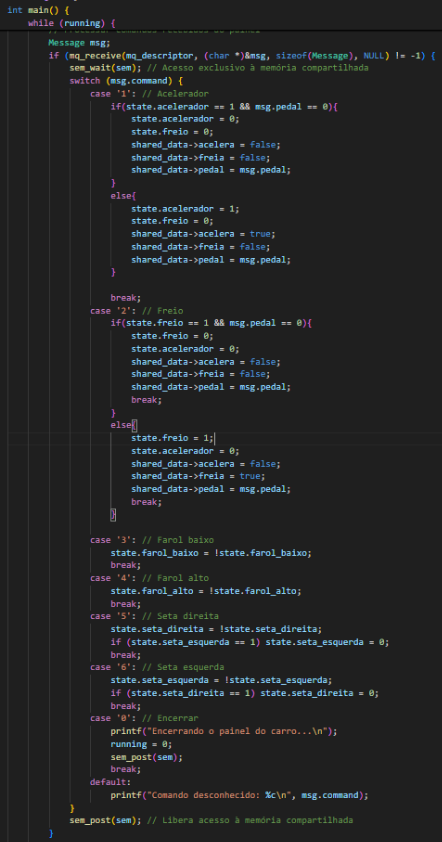

**Figura 2.2.7.: Acesso a fila de mensagens e ações*.***

O encerramento do sistema é realizado de forma ordenada, garantindo a liberação adequada de todos os recursos:

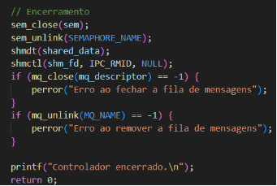

**Figura 2.2.8.: Finalização do sistema*.***

**2.3. Painel de Comandos**

O Painel de Comandos representa a interface entre o usuário e o sistema de simulação automotiva, permitindo o controle interativo dos diversos subsistemas do veículo. Este módulo implementa uma comunicação assíncrona com o Controlador Central através de uma fila de mensagens POSIX.

**2.3.1 Estrutura do Código**

O código implementa as seguintes funcionalidades essenciais:

- Interface de usuário para controle do veículo
- Comunicação via fila de mensagens POSIX
- Validação de entrada do usuário
- Controle granular dos atuadores

**2.3.2 Descrição do Código**

A estrutura Message define o formato das mensagens enviadas ao controlador, incluindo o tipo de comando e, quando aplicável, a intensidade do acionamento dos pedais.

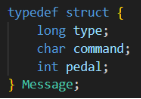

**Figura 2.3.1.: Estrutura da Mensagem*.***

A função *display\_menu()* representa a interface primária com o usuário, apresentando as opções disponíveis para controle do veículo. A opção 0 é reservada para encerrar o programa.

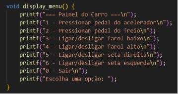

**Figura 2.3.2.: Função *display\_menu().***

A função *send\_message()* implementa o mecanismo de comunicação entre o painel e o controlador central através da fila de mensagens POSIX. Esta função aceita dois parâmetros: command, que representa o comando a ser enviado, e percentage, que indica a intensidade do comando quando aplicável (como no caso dos pedais). Internamente, a função cria uma estrutura Message, preenche seus campos com os valores apropriados e utiliza *mq\_open()* para acessar a fila de mensagens. A função implementa verificações de erro, garantindo que problemas na comunicação sejam detectados. O envio efetivo da mensagem é realizado através de *mq\_send()*.

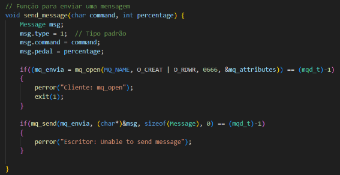

**Figura 2.3.3.: Função *send\_message().***

A função main() atua como o ponto de entrada do programa e implementa o loop principal de controle do painel. Inicialmente, configura a fila de mensagens POSIX através da estrutura mq\_attributes, definindo parâmetros importantes como o número máximo de mensagens (mq\_maxmsg) e o tamanho de cada mensagem (mq\_msgsize). O loop principal utiliza scanf() para capturar a entrada do usuário e um switch-case para processar os diferentes comandos. Para comandos que envolvem os pedais (acelerador e freio), a função implementa uma validação adicional do percentual de pressão, garantindo que os valores estejam dentro do intervalo válido de 0 a 100%.

int main() {

`    `// Configuração da fila de mensagens POSIX

`    `mq\_attributes.mq\_flags = 0;

`    `mq\_attributes.mq\_maxmsg = 10;

`    `mq\_attributes.mq\_msgsize = sizeof(Message);

`    `mq\_attributes.mq\_curmsgs = 0;

`    `display\_menu();

`    `char option;

`    `int percentage = 0;

`    `while (1) {

`        `if(scanf(" %c", &option) == 1){          

`            `switch (option) {

`                `case LEFT\_TURN\_SIGNAL:

`                    `send\_message(option, percentage);

`                    `printf("Seta esquerda acionada/desligada.\n");

`                    `break;

`                `case RIGHT\_TURN\_SIGNAL:

`                    `send\_message(option, percentage);

`                    `printf("Seta direita acionada/desligada.\n");

`                    `break;

`                `case LOW\_BEAM:

`                    `send\_message(option, percentage);

`                    `printf("Farol baixo acionado/desligado.\n");

`                    `break;

`                `case HIGH\_BEAM:

`                    `send\_message(option, percentage);

`                    `printf("Farol alto acionado/desligado.\n");

`                    `break;

`                `case ACCELERATOR: {

`                    `printf("Digite a porcentagem de pressão no pedal do acelerador (0-100): ");

`                    `scanf("%d", &percentage);

`                    `if (percentage >= 0 && percentage <= 100) {

`                        `printf("Pedal do acelerador pressionado em %d%%.\n", percentage);

`                        `send\_message(option, percentage);

`                        `break;

`                    `} else {

`                        `printf("Porcentagem inválida. Tente novamente.\n");

`                        `break;

`                    `}

`                `}

`                `case BRAKE: {

`                    `printf("Digite a porcentagem de pressão no pedal do freio (0-100): ");

`                    `scanf("%d", &percentage);

`                    `if (percentage >= 0 && percentage <= 100){

`                        `printf("Pedal do freio pressionado em %d%%.\n", percentage);

`                        `send\_message(option, percentage);

`                        `break;

`                    `} else {

`                        `printf("Porcentagem inválida. Tente novamente.\n");

`                        `break;

`                    `}

`                `}

`                `case EXIT:

`                    `printf("Encerrando o painel do carro...\n");

`                    `send\_message(option, percentage);

`                    `exit(0);

`                `default:

`                    `printf("Opção inválida. Tente novamente.\n");

`            `}

`            `display\_menu();

`        `}

`    `}

`    `if(mq\_close(mq\_envia) == (mqd\_t)-1)

`    `{

`        `perror("Escritor: mq\_close");

`        `exit(1);

`    `}

**Figura 2.3.4.: Função *main().***

**3. Resultados**

**3.1. Validação do Sistema**

Foram realizados testes para validar a funcionalidade do sistema utilizando três terminais simultâneos, representando o Controlador Central, o Simulador de Sensores e o Painel de Comandos. Durante os testes, foram executadas diversas operações de controle do veículo, começando com o veículo em estado inicial (velocidade 0 km/h, RPM em marcha lenta de 800, e temperatura em 80°C).

**Figura 3.1.1(a).: Testes no terminal (Sistema em repouso)*.***

**Figura 3.1.1(b).: Testes no terminal (Sistema em funcionamento).**

Durante o teste documentado, foram executadas as seguintes operações:

1. Acionamento do farol baixo através do comando '3' no Painel de Comandos
1. Aceleração do veículo com 50% de pressão no pedal do acelerador
1. Velocidade constante através da liberação do pedal (0%)

Os resultados observados nos três terminais demonstram a consistência e sincronização do sistema:

Terminal do Controlador (Esquerda):

- Velocidade: 39.63 km/h
- RPM: 1726
- Temperatura: 95.28 °C
- Farol baixo: Ligado
- Demais sistemas: Desativados

Terminal dos Sensores (Centro):

- RPM: 1726 rpm
- Velocidade: 39.63 km/h
- Temperatura: 95.28 °C
- Status do Pedal: Neutral

Terminal do Painel (Direita):

- Sequência de comandos executados:
  - Acionamento do farol baixo (comando 3)
  - Aceleração com 50% de pressão
  - Desaceleração para 0%

**4. Conclusão**

O desenvolvimento deste simulador de sistema automotivo representou um desafio significativo na implementação de um sistema distribuído, utilizando conceitos fundamentais de programação em C e mecanismos IPC POSIX. O projeto alcançou seus objetivos principais ao criar uma simulação realista e funcional de um ambiente de testes para veículos, demonstrando a eficácia da integração entre múltiplos processos e threads.

O uso efetivo de mecanismos de sincronização, como semáforos e mutex, garantiu um acesso seguro aos recursos compartilhados, enquanto a implementação da memória compartilhada e fila de mensagens proporcionou uma comunicação eficiente entre os diferentes componentes do sistema. 

Durante o desenvolvimento, diversos desafios técnicos foram superados com sucesso. A sincronização precisa entre múltiplos processos e o gerenciamento eficiente de recursos compartilhados representaram obstáculos significativos que foram solucionados através de uma implementação cuidadosa dos mecanismos IPC. A implementação de cálculos realistas para a simulação dos sensores e a integração eficiente entre diferentes mecanismos de comunicação também demandaram atenção especial.

O projeto demonstrou de forma conclusiva a viabilidade e eficácia da utilização de mecanismos IPC POSIX na implementação de sistemas distribuídos complexos. A experiência adquirida durante o desenvolvimento contribuiu significativamente para o entendimento prático de programação multiprocesso, mecanismos de comunicação interprocessos e sincronização em sistemas distribuídos.

