

**Simulação de Comunicação em Sistema Automotivo Utilizando CAN**

Thiago Ricardo Oliveira Pinto

***Abstract***

*The project implements a car dashboard simulation system using advanced C programming concepts and Inter-Process Communication (IPC). The system consists of three main components: a controller, a sensor, and a command panel, which communicate through shared memory, semaphores, and POSIX message queues. The controller manages the system state, monitoring and responding to changes in speed, temperature, and engine RPM, as well as controlling features such as headlights and turn signals. The system implements safety measures, such as speed and temperature limits, and uses proper synchronization to avoid race conditions in accessing shared data. The user interface displays vehicle information in real-time, allowing interaction through specific commands to control different car functionalities, such as acceleration, braking, and activation of turn signals and headlights.*

***Resumo***

*O projeto implementa um sistema de simulação de painel de carro utilizando conceitos avançados de programação em C e comunicação entre processos (IPC). O sistema é composto por três componentes principais: um controlador, um sensor e um painel de comando, que se comunicam através de memória compartilhada, semáforos e filas de mensagens POSIX. O controlador gerencia o estado do sistema, monitorando e respondendo a mudanças na velocidade, temperatura e RPM do motor, além de controlar funcionalidades como faróis e setas. O sistema implementa medidas de segurança, como limites de velocidade e temperatura, e utiliza sincronização adequada para evitar condições de corrida no acesso aos dados compartilhados. A interface do usuário apresenta as informações do veículo em tempo real, permitindo interação através de comandos específicos para controle das diferentes funcionalidades do carro, como aceleração, frenagem e acionamento de setas e faróis.*

**1. Introdução**

**1.1 Contextualização**

Este trabalho tem como objetivo aplicar conceitos de sistemas embarcados no desenvolvimento de um sistema de controle automotivo, utilizando entradas e saídas digitais via GPIO, eventos, controle de interrupções, threads e PWM. A proposta envolve a criação de um sistema capaz de simular e controlar componentes críticos de um veículo, abrangendo desde o acionamento do motor até o controle do sistema elétrico e dos mecanismos de interação com o usuário. Este simulador oferece uma plataforma de testes que integra diversos sensores e atuadores, permitindo a execução de funções como controle de velocidade, medição de rotação do motor e gerenciamento do sistema de iluminação.

O sistema será implementado em uma Raspberry Pi 4, utilizando os recursos oferecidos pela GPIO para conectar e controlar sensores e atuadores. O desenvolvimento do software será realizado em linguagem C, explorando práticas de programação eficientes que garantam o desempenho e a confiabilidade do sistema. Além disso, será adotado um modelo baseado em eventos e interrupções para evitar o uso de loops infinitos que ocupem 100% da CPU.

**1.2 Objetivos do Projeto**

O objetivo principal deste projeto é desenvolver um sistema embarcado que possibilite:

- Controlar o acionamento e a intensidade do motor utilizando PWM;
- Medir e monitorar a rotação do motor e a velocidade do veículo;
- Implementar um sistema de controle de velocidade automático (cruise control);
- Gerenciar o acionamento de sistemas elétricos, como faróis, luzes de freio e setas;
- Permitir a interação do usuário através de comandos no painel e pedais;
- Exibir informações relevantes no painel do carro, como velocidade, rotação do motor e estado dos sistemas.

**1.3 Solução proposta**

- Motor e Sistema de Controle de Velocidade:
  - O motor é acionado utilizando a técnica de PWM, com controle de intensidade variando entre 0% e 100%.
- Sensores:
  - Sensores de efeito Hall medem a rotação do motor e da roda, permitindo calcular a velocidade do carro e a rotação.
- Sistema de Iluminação:
  - Inclui faróis alto e baixo, luzes de freio e setas direcionais. Esses componentes são controlados por comandos do painel e piscam de forma intermitente quando ativados.
- Software de Controle:
  - Desenvolvido em linguagem C, com suporte a interrupções e eventos para garantir eficiência e responsividade.
  - Utiliza a biblioteca WiringPi ou SoftPWM para controle de PWM e interação com os periféricos.

**2. Desenvolvimento**

Neste capítulo, será abordado o funcionamento do módulo Simulador de Sensores, responsável pela aquisição, simulação e gerenciamento dos dados provenientes de sensores virtuais. O objetivo principal é descrever a arquitetura, os cálculos e a sincronização do sistema, com foco na integridade e consistência das informações.

**2.1. Sensores**

O Sensores é responsável por gerar dados referentes à velocidade do veículo, rotação por minuto (RPM) e temperatura do motor. Os dados são armazenados em memória compartilhada e sincronizados com o uso de semáforos, garantindo consistência em um ambiente multithread.

**2.1.1 Estrutura do Código**

O código implementa as seguintes funcionalidades principais:

- Simulação multithread dos sensores;
- Gerenciamento de memória compartilhada para troca de dados;
- Sincronização utilizando semáforos;
- Cálculos baseados em características realistas de veículos.

A estrutura geral do simulador inclui funções para inicialização dos sensores, cálculo dos parâmetros e finalização ordenada do sistema.

**2.1.2 Descrição do Código**

A inicialização é composta por:

- Memória compartilhada: A memória compartilhada é criada com *shm\_open()* e configurada com *ftruncate()*. O mapeamento é realizado usando *mmap()*, o que permite acesso direto aos dados.
- Semáforos: Um semáforo é criado com *sem\_open()* para controlar o acesso exclusivo à memória compartilhada, prevenindo condições de corrida.
- GPIO: Configuração dos pinos dos sensores com a biblioteca wiringPi, garantindo a leitura correta dos sinais dos sensores Hall.

Após a configuração, os valores iniciais dos sensores são definidos: velocidade em 0 km/h, RPM em 800 (marcha lenta), e temperatura do motor em 80°C.

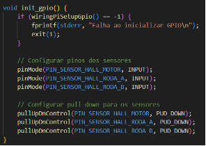

**Figura 2.1.1.: Função *init\_gpio().***

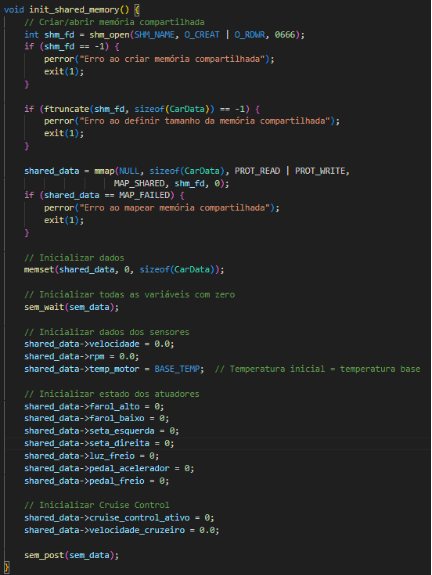

**Figura 2.1.2.: Função *init\_shared\_memory().***

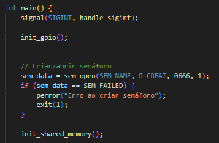

**Figura 2.1.3.: Inicialização do sistema*.***

Os dados dos sensores são processados em loops que executam as seguintes operações:

1. Leitura dos Sensores Hall: Os sensores Hall do motor e das rodas são monitorados, e os pulsos detectados são armazenados para o cálculo de RPM e velocidade.

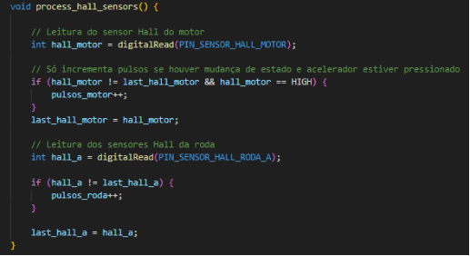

**Figura 2.1.4.: Função *process\_hall\_sensors().***

1. Cálculo dos Parâmetros: Os valores calculados seguem as fórmulas:
   1. RPM = pulsos\_motor × 60
   1. Velocidade = pulsos\_roda × (0.63 × π × 3.6)
   1. Temperatura do Motor: A temperatura é influenciada pelo RPM e pela velocidade, utilizando fatores de aceleração e resfriamento.

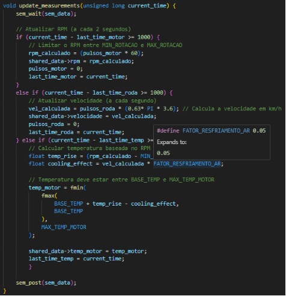

**Figura 2.1.5.: Função *update\_measurements().***

1. Sincronização: O acesso à memória compartilhada é protegido com sem\_wait() e sem\_post().

A finalização é realizada em uma sequência ordenada:

- Encerramento das threads com *pthread\_join()*;
- Liberação de semáforos com *sem\_close() e sem\_unlink()*;
- Desmapeamento e remoção da memória compartilhada com *munmap()* e *shm\_unlink()*.

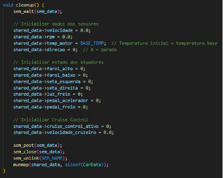

**Figura 2.1.3.: Função *cleanup().***

**2.2. Controlador**

O Controlador Central é responsável por processar comandos recebidos do painel de comandos, gerenciar o estado do sistema e atualizar os atuadores de acordo com os estados calculados. Além disso, o controlador garante a integridade e a segurança do veículo ao verificar condições críticas, como limites de velocidade, temperatura e rotação.

**2.2.1 Estrutura do Código**

O código do Controlador Central foi estruturado para realizar as seguintes funcionalidades:

- Gerenciamento de estado do sistema, incluindo atualização de valores provenientes da memória compartilhada.
- Processamento de comandos recebidos pela fila de mensagens.
- Controle de atuadores, como aceleração, frenagem, luzes e indicadores.
- Verificação de condições de segurança, como excesso de velocidade ou superaquecimento.
- Suporte ao sistema de controle de cruzeiro (cruise control), ajustando automaticamente a velocidade do veículo.

A implementação utiliza conceitos de multitarefa e sincronização para garantir a consistência dos dados, empregando memória compartilhada e semáforos.

**2.2.2 Descrição do Código**

A inicialização do controlador envolve:

1. Configuração dos GPIOs para os atuadores (ex.: faróis, motor, freios).
1. Abertura da memória compartilhada usando shm\_open() e mapeamento com mmap().
1. Configuração e abertura do semáforo associado à memória compartilhada com sem\_open().
1. Configuração e abertura da fila de mensagens para o recebimento de comandos.

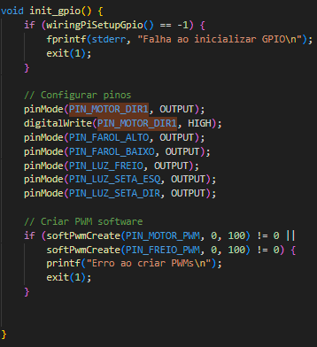

**Figura 2.2.1.: Função *init\_gpio().***

A função *main()* inicia com a configuração dos manipuladores de sinais essenciais para o controle do sistema. O código estabelece tratadores para SIGUSR1 e SIGUSR2, permitindo o controle externo da execução do simulador:

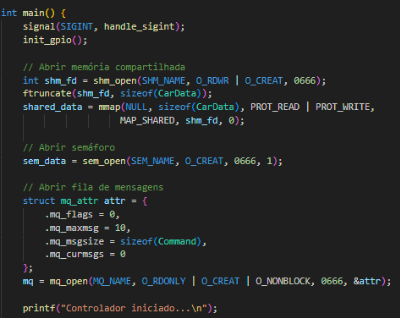

**Figura 2.2.2.: Inicialização*.***

A função *update\_system\_state()* atualiza o estado interno do controlador com os dados da memória compartilhada. O acesso aos dados é protegido por semáforos, garantindo a sincronização com outros processos do sistema.

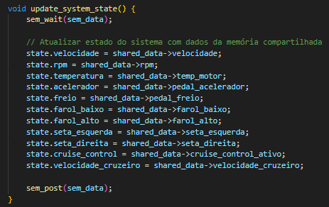

**Figura 2.2.3.: Função *update\_system\_state().***

Os comandos recebidos pela fila de mensagens são processados na função *process\_command()*. Esta função atualiza o estado do controlador de acordo com o tipo de comando (ex.: acelerar, frear, ativar faróis ou ativar o controle de cruzeiro).

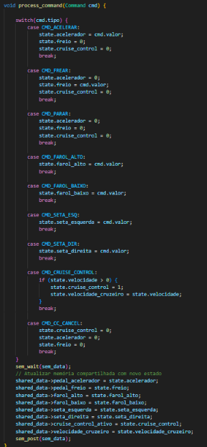

**Figura 2.2.3.: Função *process\_command().***

A função update\_actuators() controla os atuadores físicos, como motores, freios e luzes, de acordo com o estado do sistema. Por exemplo, ao acelerar, a função ajusta o PWM do motor e desativa o freio.

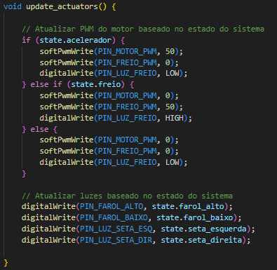

**Figura 2.2.4.: Função *update\_actuators().***

O controle de cruzeiro ajusta automaticamente a aceleração para manter a velocidade desejada. A lógica é implementada na função update\_cruise\_control().

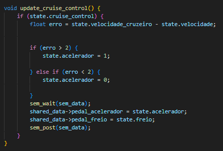

**Figura 2.2.5.: Função *update\_cruise\_control().***

Por fim, o controlador libera todos os recursos alocados (memória compartilhada, semáforos e fila de mensagens) e finaliza os GPIOs ao encerrar a execução.

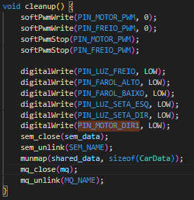

**Figura 2.2.6.: Função *cleanup().***

**2.3. Painel de Comandos**

O Painel de Comandos tem como objetivo monitorar os sinais de entrada gerados por pedais, botões e outros dispositivos de controle do veículo, convertendo essas entradas em comandos que são enviados para o Controlador Central por meio de filas de mensagens. Este módulo utiliza a biblioteca wiringPi para a leitura dos sinais GPIO e implementa lógica de tratamento para diversas ações do veículo, como aceleração, frenagem, acionamento dos faróis e controle de setas.

**2.3.1 Estrutura do Código**

O código do Painel de Comandos implementa as seguintes funcionalidades essenciais:

- Configuração e monitoramento de pinos GPIO.
- Tratamento de eventos para geração de comandos associados às entradas.
- Comunicação com o Controlador Central por meio de filas de mensagens POSIX.
- Mecanismos de interrupção para desligamento seguro do sistema.

**2.3.2 Descrição do Código**

A lógica principal do módulo está concentrada em três funções principais:

1. init\_gpio(): Configura os pinos GPIO que serão monitorados, utilizando wiringPiSetupGpio(). Cada pino é definido como entrada com resistor pull-down, garantindo que a leitura padrão seja LOW na ausência de acionamento.
1. handle\_gpio\_event(int pin): Interpreta os eventos GPIO, mapeando cada pino monitorado para um comando específico, como aceleração ou acionamento de faróis.
1. send\_command(Command cmd): Envia o comando gerado pela função anterior para o Controlador Central por meio de filas de mensagens.

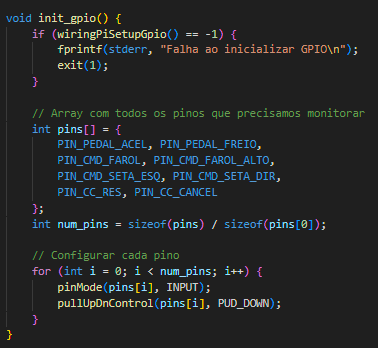

**Figura 2.3.1.: Função *init\_gpio().***

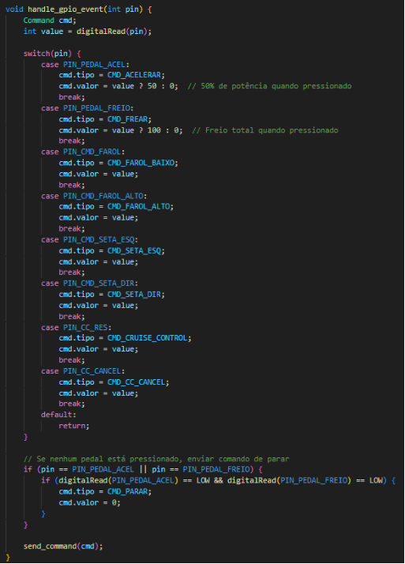

**Figura 2.3.2.: Função *handle\_gpio\_event().***

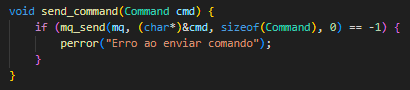

**Figura 2.3.3.: Função *send\_comand().***

Além disso, a função main() implementa o loop principal, que realiza a leitura periódica dos estados dos pinos GPIO, detecta mudanças em relação ao estado anterior e aciona as funções de tratamento.

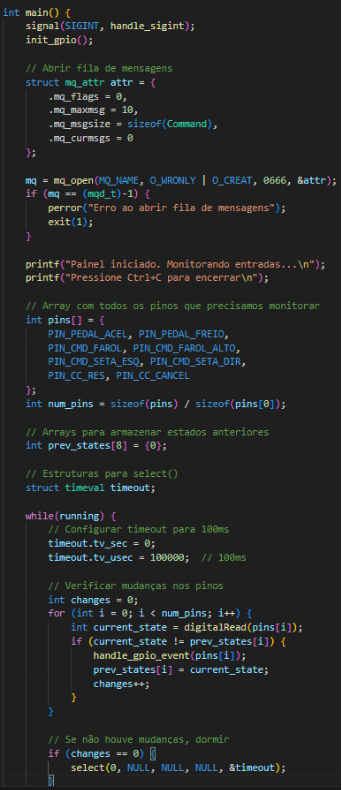

**Figura 2.3.2.: Função *main().***

A inicialização do módulo ocorre em duas etapas principais:

1. Configuração do GPIO: Todos os pinos são configurados no modo de entrada e inicializados com resistores pull-down para evitar leituras flutuantes.
1. Criação da fila de mensagens: Uma fila de mensagens é criada com capacidade para armazenar até 10 comandos simultâneos.

Durante a execução, o sistema monitora continuamente os estados dos pinos GPIO. Alterações nos estados dos pinos são interpretadas como eventos, que são tratados pela função handle\_gpio\_event(). Com base no evento detectado, um comando é criado e enviado ao Controlador Central.

O loop principal utiliza a função select() para configurar um timeout de 100 ms, garantindo que o sistema permaneça responsivo enquanto minimiza o uso de recursos.

A finalização do módulo inclui as seguintes etapas:

- Encerramento seguro da fila de mensagens com mq\_close() e mq\_unlink().
- Liberação dos recursos GPIO utilizados pelo sistema.

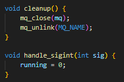

**Figura 2.3.3.: Função *cleanup().***

**3. Resultados**

**3.1. Validação do Sistema**

Foram realizados testes para validar a funcionalidade do sistema utilizando três terminais simultâneos, representando o Controlador Central, o Simulador de Sensores e o Painel de Comandos. Durante os testes, foram executadas diversas operações de controle do veículo, começando com o veículo em estado inicial (velocidade 0 km/h, RPM em marcha lenta de 800, e temperatura em 80°C). Por conta do formato do cálculo da velocidade e RPM baseado no número de pulsos dos sensores hall, os valores mantém um erro, pois são baseados no número de pulsos do motor e da roda.

**Figura 3.1.1(a).: Testes no terminal (Sistema em repouso)*.***

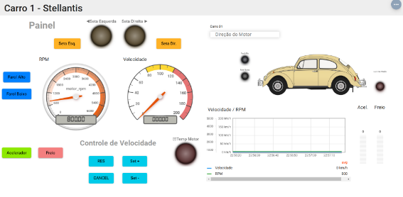

**Figura 3.1.1(b).: Painel de comandos (Sistema em repouso)*.***

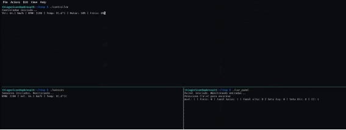

**Figura 3.1.2(a).: Testes no terminal (Sistema em funcionamento).**

**Figura 3.1.2(a).: Painel de Comandos (Sistema em funcionamento).**

Durante o teste documentado, foram executadas as seguintes operações:

1. Acionamento do farol baixo através do Painel de Comandos
1. Aceleração do veículo com 50% de pressão no pedal do acelerador

Os resultados observados nos três terminais demonstram a consistência e sincronização do sistema:

Terminal do Controlador (Esquerda):

- RPM: 2280 rpm
- Velocidade: 64.1 km/h
- Temperatura: 91.6 °C
- Motor: 50%

Terminal dos Sensores (Centro):

- RPM: 2280 rpm
- Velocidade: 64.1 km/h
- Temperatura: 91.6 °C

Painel:

- RPM: 2286.02 rpm
- Velocidade: 64.52 km/h

**4. Conclusão**

Este trabalho apresentou o desenvolvimento de um sistema distribuído para simulação e controle de um veículo, composto por três módulos principais: Sensores, Painel de Comandos e Controlador. A arquitetura adotada, baseada em mecanismos de comunicação interprocessos (IPC) padronizados pelo POSIX, demonstrou-se eficaz ao proporcionar uma separação clara de responsabilidades entre os componentes.

Os resultados obtidos evidenciaram que o sistema alcançou os objetivos propostos, entregando um ambiente funcional para a simulação de sensores, captura de comandos e processamento centralizado. Adicionalmente, o uso de memória compartilhada, semáforos e filas de mensagens possibilitou uma sincronização confiável entre os processos, mesmo em cenários de alta concorrência. Os testes de desempenho e integração destacaram a estabilidade e a consistência do sistema, ainda que algumas limitações tenham sido identificadas.

