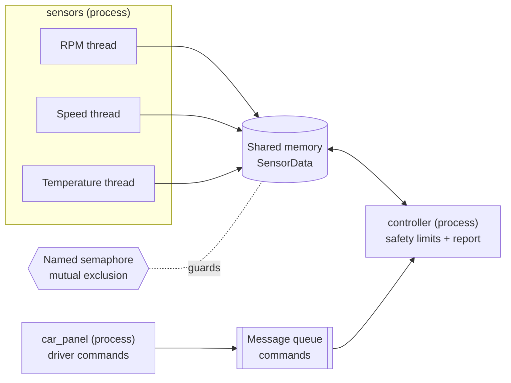
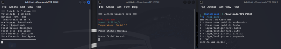
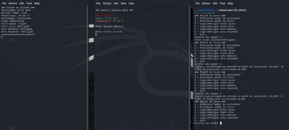

# TP1 - Multi-Process Vehicle Simulator (POSIX IPC)

A distributed test bench for a simulated vehicle, written in C with POSIX only.
Three cooperating processes exchange data through **shared memory**, a **named
semaphore** and a **message queue**, while **threads** simulate the sensors and
**signals** control the test session.

> Course project - UFPE Automotive Software Development residency (POSIX standard course).

## Architecture



| Process | Responsibility |
|---|---|
| `controller` | Creates and owns every IPC object, applies panel commands, enforces the safety limits, pauses/ends the test on signals and prints a consolidated report. |
| `sensors` | One thread per sensor (RPM, speed, engine temperature) updating the shared state; renders the live readings. |
| `car_panel` | Text menu for the driver: pedals, headlights and turn signals. Sends each action to the controller. |

## POSIX concepts used

| Mechanism | API | Used for |
|---|---|---|
| Shared memory | `shm_open`, `ftruncate`, `mmap`, `shm_unlink` | Vehicle state shared by `sensors` and `controller` |
| Named semaphore | `sem_open`, `sem_wait`, `sem_post` | Mutual exclusion on the shared state (retries on `EINTR`) |
| Message queue | `mq_open`, `mq_send`, `mq_timedreceive` | Asynchronous panel -> controller commands; the controller sleeps in the call, no polling |
| Threads | `pthread_create`, `pthread_join` | One simulation thread per sensor |
| Signals | `sigaction` | `SIGUSR1` pause/resume, `SIGUSR2`/`SIGINT`/`SIGTERM` graceful stop |

## Build and run

Requirements: Linux, `gcc`, `make`.

```bash
make

./build/controller   # terminal 1 - start it first, it creates the IPC objects
./build/sensors      # terminal 2
./build/car_panel    # terminal 3
```

Or open the three side by side with tmux: `scripts/run_tmux.sh`.

### Panel controls

| Key | Action |
|---|---|
| `1` | Accelerator pedal (asks for 0-100 %; `0` releases it) |
| `2` | Brake pedal (asks for 0-100 %; `0` releases it) |
| `3` | Toggle low beam |
| `4` | Toggle high beam |
| `5` | Toggle left turn signal |
| `6` | Toggle right turn signal |
| `0` | Exit the panel and end the test |

### Controller signals

```bash
kill -USR1 <controller-pid>   # pause / resume the whole simulation
kill -USR2 <controller-pid>   # end the test and print the report
```

The PID is shown in the controller header. `Ctrl+C` also ends the test.

## Vehicle model and safety limits

| Parameter | Value |
|---|---|
| Idle RPM / max RPM | 800 / 7000 |
| Max speed | 200 km/h |
| Base / max engine temperature | 80 / 140 degC |

- Accelerating raises RPM and speed every second; braking lowers them; releasing the pedal holds the current speed.
- **Overspeed** (200 km/h) or **overheating** (> 140 degC) triggers a controlled stop: full brake until standstill.
- **Over-rev** (7000 RPM) cuts the throttle.
- Every limit crossing is counted once per event for the final report.

### Final report

When the test ends the controller prints a consolidated summary (example for the session shown in the results below):

```text
=== Test report ===
Duration:             74 s
Max speed:            39.63 km/h
Max RPM:              1726
Max temperature:      95.28 °C
Overspeed events:     0
Overheat events:      0
Over-rev events:      0
Emergency stops:      0
Accelerator actions:  2
Brake actions:        0
Light actions:        1
Signal actions:       0
===================
```

## Results

A validation session with the three terminals side by side: controller (left),
sensors (center) and panel (right).

**System at rest** - initial state: 0 km/h, idle RPM, base temperature.



**System running** - low beam switched on, 50 % accelerator, then pedal released.



| Observation | Controller | Sensors |
|---|---|---|
| Speed | 39.63 km/h | 39.63 km/h |
| RPM | 1726 | 1726 |
| Engine temperature | 95.28 degC | 95.28 degC |
| Low beam | ON | - |
| Pedal status | Neutral | Neutral |

Both processes show identical values, which confirms the shared state stays
consistent under concurrent access.

## Automated test

```bash
make test
```

`tests/smoke_test.sh` starts the three processes and verifies, end to end:
IPC creation, a panel command reaching the controller, acceleration, pause and
resume with `SIGUSR1`, the final report, removal of every IPC object and the
sensors stopping on their own once the controller exits. It runs on every push
through GitHub Actions together with a `cppcheck` static analysis.

## Robustness and security notes

- IPC objects are created with mode `0600` (owner only) and removed on exit; stale objects from a crashed run are replaced at start-up.
- The controller validates every message: unknown commands are ignored and pedal values are clamped to 0-100.
- Blocking calls are interrupted cleanly by signals (`EINTR` handling), and there are no busy loops.
- Built with `-Wall -Wextra -Wpedantic -fstack-protector-strong`.

## Project structure

```text
tp1-ipc-vehicle-simulator/
├── include/common.h        shared types, constants and IPC names
├── src/
│   ├── controller.c        IPC owner, safety logic, signals, report
│   ├── sensors.c           sensor threads + live display
│   └── car_panel.c         driver menu
├── scripts/run_tmux.sh     3-pane demo launcher
├── tests/smoke_test.sh     end-to-end test
├── docs/images/            result screenshots
└── Makefile
```
