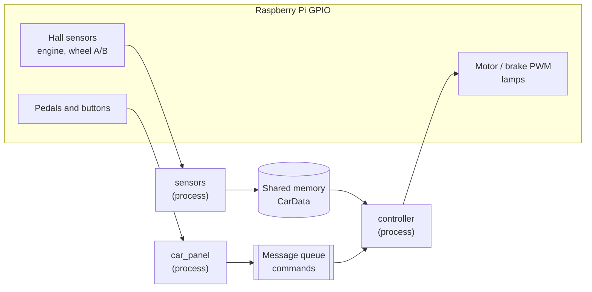
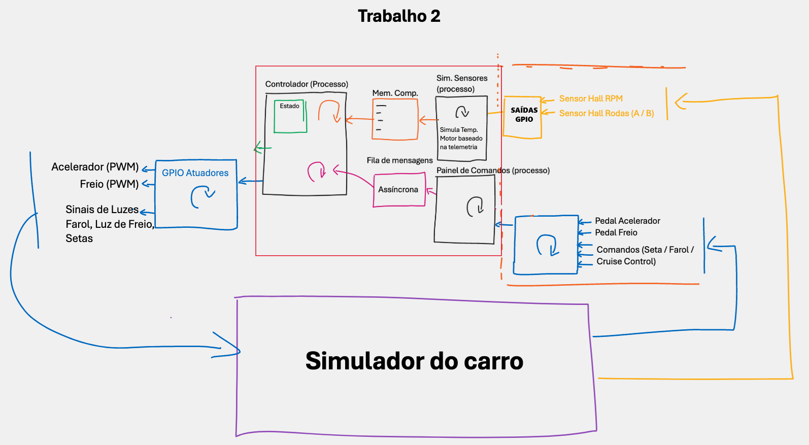
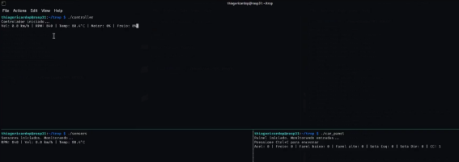
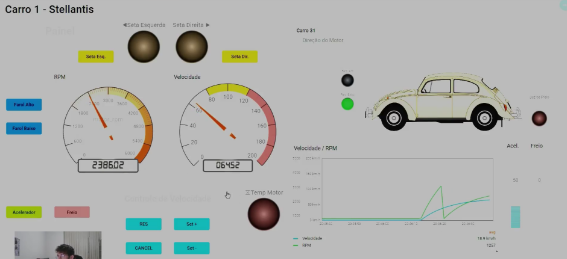

# TP2 - Raspberry Pi Vehicle Controller (GPIO, PWM and POSIX)

Embedded-style control software for a simulated car running on a **Raspberry Pi 4**:
Hall-sensor acquisition, PWM motor and brake drive, lights, turn signals and an
on/off **cruise control**. Three C processes cooperate through POSIX shared
memory, a named semaphore and a message queue, and the whole system also runs
**without hardware** thanks to a built-in GPIO simulator.

> Course project - UFPE Automotive Software Development residency (POSIX standard course).

## Architecture



| Process | Responsibility |
|---|---|
| `sensors` | Samples the Hall sensors every millisecond, converts 1 s pulse windows into RPM, speed, direction and engine temperature, and publishes them in shared memory. |
| `car_panel` | Watches the pedals and buttons (GPIO inputs) and turns each change into a command. A terminal status line shows the input states. |
| `controller` | Owns the IPC objects, applies commands, runs the safety limits and the cruise control, and drives the actuators. |

Original design sketch:



## Hardware and GPIO map

Raspberry Pi 4, DC motor with power driver, two Hall sensors (engine and wheel).
Pins use BCM numbering and are defined in [`include/common.h`](include/common.h).

| Signal | GPIO | Dir | Signal | GPIO | Dir |
|---|---|---|---|---|---|
| Motor direction 1 | 17 | OUT | Accelerator pedal | 27 | IN |
| Motor direction 2 | 18 | OUT | Brake pedal | 22 | IN |
| Motor power (PWM) | 23 | OUT | Hall sensor, engine | 11 | IN |
| Brake intensity (PWM) | 24 | OUT | Hall sensor, wheel A | 5 | IN |
| Low beam lamp | 19 | OUT | Hall sensor, wheel B | 6 | IN |
| High beam lamp | 26 | OUT | Low beam command | 16 | IN |
| Brake lamp | 25 | OUT | High beam command | 1 | IN |
| Left turn signal lamp | 8 | OUT | Left turn signal command | 20 | IN |
| Right turn signal lamp | 7 | OUT | Right turn signal command | 21 | IN |
| Engine temperature lamp | 12 | OUT | Cruise control resume | 13 | IN |
| | | | Cruise control cancel | 0 | IN |

## Design

### Event-driven, no busy loops

- The controller sleeps inside `mq_timedreceive()` and wakes up on a command or every 20 ms to run its control cycle.
- The panel waits in `select()` (50 ms) and the sensors sleep 1 ms between samples, so no process spins at 100 % CPU.

### Sensor acquisition

| Quantity | Computation |
|---|---|
| Engine RPM | rising edges of the engine Hall sensor (1 pulse per turn) x 60, scaled to the real window length |
| Speed | wheel channel A edges x wheel circumference (0.63 m diameter) x 3.6 |
| Direction | channel B level when channel A rises (A leads B = forward) |
| Engine temperature | 80 degC + 0.01 x (RPM - 800) - 0.05 x speed, limited to 80-140 degC |

The fastest signal (7000 RPM, about 117 Hz) is far below the 1 kHz sampling rate.

### Motor and brake drive

- Soft PWM at **1 kHz**: 10 steps of 100 us (`PWM_RANGE = 10`), duty converted from percent.
- Pedals are digital: accelerator = 50 % duty, brake = 100 % duty.
- Motor driver truth table: free `(0,0)`, forward `(1,0)`, brake `(1,1)`.
- The brake has priority over the throttle; a rev limiter cuts the throttle at 7000 RPM.

### Cruise control

- `RES` stores the current speed as the set point; the brake pedal or `CANCEL` disengages it.
- Simple **on/off control with hysteresis** (+/- 1 km/h): throttle on below the band, off above it.
- The accelerator pedal temporarily overrides it. Type `+` or `-` then Enter in the panel terminal to move the set point by 1 km/h.

### Lights

- Headlights toggle on each button press (low and high beam are mutually exclusive).
- Turn signals toggle on each press, blink once per second and cancel each other.
- The brake lamp follows the brake output; the engine temperature lamp lights at 120 degC.

### Safety

- Speed >= 200 km/h or engine temperature >= 140 degC triggers a controlled stop (full brake until standstill) and cancels the cruise control.
- `SIGINT`/`SIGTERM` stop every process cleanly: PWM outputs and lamps are switched off and the IPC objects are removed.

## Build and run

### On the Raspberry Pi

Requirements: Raspberry Pi OS, `gcc`, `make` and [WiringPi](https://github.com/WiringPi/WiringPi).

```bash
make

sudo ./build/controller   # terminal 1 - start it first, it creates the IPC objects
sudo ./build/sensors      # terminal 2
sudo ./build/car_panel    # terminal 3
```

`scripts/run_tmux.sh` opens the three side by side. GPIO access needs root.

### On any Linux machine (GPIO simulator)

`make SIM=1` replaces WiringPi with a shared-memory pin table
([`sim/`](sim)) and builds `gpio_ctl`, a tool to play the part of the car and
of the driver:

```bash
make SIM=1

./build/controller        # terminal 1
./build/sensors           # terminal 2
./build/car_panel         # terminal 3

# terminal 4
./build/gpio_ctl pulse hall-motor 38 20 &      # engine at ~2280 RPM
./build/gpio_ctl pulse hall-wheel-a 4.5 20 &   # wheel at ~64 km/h
./build/gpio_ctl set accel 1                   # press the accelerator pedal
./build/gpio_ctl pwm motor-pwm                 # 5  (50 % of the 10-step PWM)
./build/gpio_ctl dump                          # every active pin
./build/gpio_ctl reset                         # clear the virtual pins
```

`gpio_ctl` accepts pin numbers or names (`accel`, `brake`, `cmd-low`,
`cmd-left`, `cc-resume`, `hall-motor`, `lamp-low`, `motor-pwm`, ...); run it
without arguments for the full list of commands.

## Requirements coverage

| Requirement | Implementation |
|---|---|
| C with a Makefile, README with build/run | `Makefile`, this document |
| No infinite loop using 100 % CPU | Blocking `mq_timedreceive`, `select` and 1 ms sleeps |
| On/off speed control with PWM, brake via PWM, 1 kHz | Cruise control with hysteresis, soft PWM range 10 x 100 us |
| Manual pedals and automatic cruise control | Accelerator/brake pedals, `RES`, `CANCEL`, `+`/`-` |
| Engine Hall sensor up to 7000 RPM, one pulse per turn | Rising-edge counting |
| Wheel Hall sensor with A/B channels | Edge counting on A, direction from B |
| Headlights, brake lamp, temperature lamp, blinking turn signals | Lamp outputs, 1 Hz blink |
| Terminal panel with live indications | `car_panel` status line, controller status line |
| `SIGINT` shuts down peripherals and actuators | Signal handlers, `release_gpio()` |

## Results

Validation on the Raspberry Pi 4 rig, with a remote ThingsBoard dashboard that
simulates the car.

**System at rest** - controller (top), sensors (bottom left) and panel (bottom right).




**System running** - low beam on and 50 % accelerator.




| Quantity | Controller / sensors | Dashboard |
|---|---|---|
| Engine speed | 2280 RPM | 2286.02 RPM |
| Vehicle speed | 64.1 km/h | 64.52 km/h |
| Engine temperature | 91.6 degC | - |
| Motor power | 50 % | - |

The values measured by the Pi agree with the dashboard reading to within 1 %.

## Automated test

```bash
make test
```

Builds the simulated variant and runs `tests/smoke_test.sh`, which drives the
virtual pins with `gpio_ctl` and checks the controller outputs end to end:
headlight toggle, 50 % PWM on the accelerator pedal, motor direction pins,
RPM measurement from engine pulses, full brake with brake lamp, blinking turn
signal, cruise control throttle request and cancel, and a clean `SIGINT`
shutdown that clears the outputs and removes every IPC object. It runs on every
push through GitHub Actions together with a `cppcheck` static analysis.

## Robustness and security notes

- IPC objects are created with mode `0600` (owner only) and removed on exit; stale objects from a crashed run are replaced at start-up.
- The controller discards messages with an unknown command type and clamps pedal values to 0-100 %.
- Blocking calls are interrupted cleanly by signals (`EINTR` handling).
- Built with `-Wall -Wextra -Wpedantic -fstack-protector-strong`.

## Project structure

```text
tp2-gpio-vehicle-controller/
├── include/common.h        GPIO map, constants, shared types, IPC names
├── src/
│   ├── controller.c        IPC owner, safety, cruise control, actuators
│   ├── sensors.c           Hall-sensor acquisition
│   └── car_panel.c         pedal and button monitor
├── sim/                    wiringPi / soft-PWM replacement for make SIM=1
├── tools/gpio_ctl.c        shell control of the virtual GPIO pins
├── scripts/run_tmux.sh     3-pane demo launcher
├── tests/smoke_test.sh     end-to-end test (simulated build)
├── docs/images/            design sketch and result screenshots
└── Makefile
```
